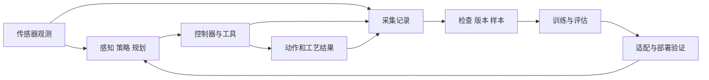

# T1：完整系统与两个工业工序

读完应能回答：任务是谁在做，学习模型解决哪一段，数据管线与机器人运行如何连接。

## 两条相连的流程

工作系统在现场完成任务。数据管线组织记录并加工成样本；训练更新模型参数；部署把经过验证的模型接入工作系统。录制、训练与控制可以运行在不同计算机上，不必在每次动作前重新训练。

“大脑”在工程上需要拆成明确功能：理解任务、识别与定位对象、决定动作、生成可执行运动，以及判断结果。它们可以是多个模型、传统算法或同一模型内的模块，不能仅凭“大脑／小脑”名称推断实现。

## 案例一：料盘取件与螺丝装配

参考任务：取一个壳体、放入夹具、对准螺丝孔、使用供料拧紧系统、检查结果。先限定一种工件与工具；散料中捏取螺丝另行作为任务。

| 阶段 | 候选执行方式 | 要记录什么 |
| --- | --- | --- |
| 取件 | 视觉定位＋规划，或学习式抓取 | 图像、抓取目标、命令、状态和结果 |
| 放入夹具 | 固定程序或局部调整策略 | 放置轨迹、夹具事件、到位确认 |
| 对准 | 视觉规划或从示范学习的技能 | 观测、有效示教命令、执行目标、实际状态 |
| 拧紧 | 工具控制器执行指定工艺 | 工具程序、扭矩／角度、结束码 |
| 质检与异常 | 工艺规则、检测与人工复核 | 工件／孔位号、质量结论、返工与接管 |

Micropsi＋DEPRAG 的公开案例采用原生控制器接近、MIRAI 对准、专业工具拧紧的分工。它是理解系统边界的参照，不是本项目已部署的方案。[厂商工站说明](https://www.micropsi-industries.com/mirai-cases/deprag-micropsi-automated-screwdriving)

## 案例二：搬箱子

把“搬箱子”拆成发现目标、移动到操作位置、抓取、抬起、持物移动、放下、确认。完整评估要包含放置成功、箱体与物料质量、人工介入和周期时间，不能只看能否把箱子举起来。

固定机械臂可能只完成工作范围内的取放。轮式设备要额外解决移动。双足 G1 还需考虑抓取与载荷变化对平衡和脚部接触的影响。场景决定是否需要移动、双足或双手，不预设人形是唯一方案。

这两个案例可共享数据身份、版本、来源、处理记录，但实际观测、动作、控制器和验收字段不同。

## 初步选择工业试点的方法

带着“位置变化、换型、人工处理异常、质量判定困难”去观察工序，先量出现状，再比较治具、供料、照明、传统控制和学习方法的改进成本。候选清单和匿名调研卡见 [场景文档](../../04-scenarios-and-first-workstation.md)。

## 实操与复述

无需设备：把一个工序写成“谁读取什么 → 谁决定什么 → 谁执行 → 谁确认结果”。尚不明确的接口写未知。

向主管复述：“我们要验证学习能力在具体工序中承担哪一段，并建立可追溯的数据与训练流程。机器人形态、控制方案和模型选择由任务条件共同决定。”
